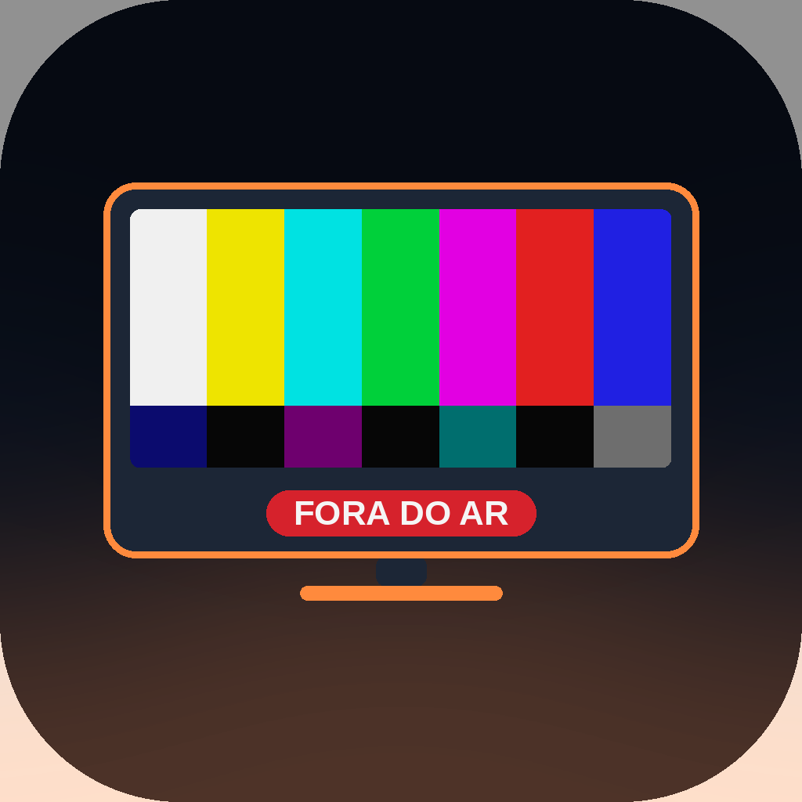
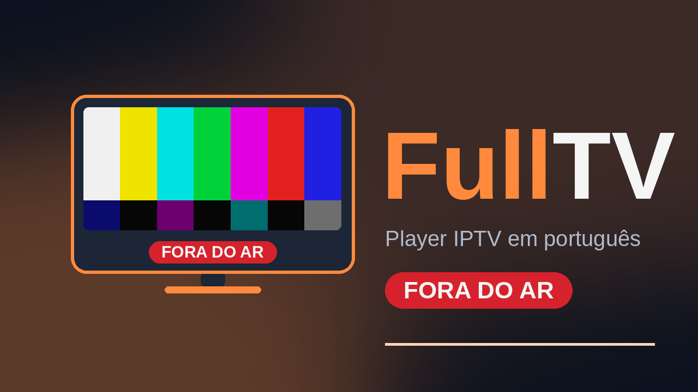

# FullTV

**Player IPTV gratuito e open-source para Android TV, Fire TV, celulares e tablets.**

Sem conta. Sem assinatura. Nenhum servidor nosso entre você e seu provedor.

O FullTV é um fork do [OpenTV](https://github.com/opentvproject/opentv), com identidade
própria, tema laranja, português do Brasil, importação automática de EPG e gravação em MP4.

<p align="center">
  
  
</p>

> **Status:** build de desenvolvimento (debug). Os recursos novos de gravação MP4 e densidade
> do guia ainda não passaram por teste extensivo em todos os aparelhos. Seu feedback é
> bem-vindo nas issues.

## O que ele faz

- **TV ao vivo** via Xtream Codes e listas M3U/M3U8
- **EPG automático** — lê os endereços `url-tvg` da lista e importa os guias sozinho,
  inclusive `.gz` e `.xz`
- **Guia responsivo** — composição janelada (só desenha o que está perto da tela),
  três densidades (Compacto, Normal e Confortável) e rolagem automática ao navegar com o D-pad
- **Gravação (DVR)** — no aparelho, pendrive/USB ou NAS (SMB); gravação manual padrão de 1 hora
- **MP4 opcional** — grava em TS e converte para MP4 após parar, sem re-encode; se o codec não
  for compatível, mantém o TS original
- **Catch-up/arquivo**, lembretes de programas, filmes e séries com retomada
- **Favoritos, categorias, ocultar canais, busca**, picture-in-picture e controle de aspecto
- **Sincronização entre seus aparelhos** pela sua rede ou NAS, sem servidor nosso
- **Perfis, PIN parental** e vários idiomas, com português do Brasil completo
- **Feito para controle remoto** — navegação por D-pad de ponta a ponta
- **Um APK** para Android TV, Fire TV, celulares e tablets

## Novidades desta versão (FullTV)

| Área | Mudança |
| --- | --- |
| Marca | Nome, ícone (TV com barras de cores, fora do ar), banner e textos “FullTV” |
| Visual | Tema laranja em toda a interface |
| Idioma | Tradução pt-BR completa e opção “Português (Brasil)” |
| EPG | Importação automática de todos os `url-tvg` encontrados na lista M3U |
| Guia | Performance com janela de renderização, densidade ajustável e foco D-pad com auto-scroll |
| Gravação | Formato TS ou MP4 (conversão sem re-encode) e gravação manual padrão de 1h |

## Instalar

1. Baixe o APK na página de **Releases** deste repositório.
2. Autorize a instalação de apps de fontes desconhecidas no aparelho.
3. Instale o APK.

As versões antigas ficam preservadas na página de Releases. O aplicativo verifica novas versões
periodicamente e pergunta antes de baixar e abrir o instalador do Android. A variante debug recebe
um APK debug compatível; a variante release recebe o APK release correspondente.

O build de desenvolvimento usa o applicationId `app.opentv.debug`, então ele **instala ao lado**
do OpenTV oficial sem substituí-lo.

No Android TV/Fire TV, você pode usar o app **Downloader** com o link direto do APK ou:

```bash
adb install -r FullTV-0.11.10-debug.apk
```

## Compilar

Requisitos:

- JDK **17** (JDK 21 quebra o `JdkImageTransform` do AGP usado pelo projeto)
- Android SDK com plataforma **35** e build-tools 35.0.0
- Conexão com a internet na primeira compilação (Gradle baixa as dependências)

```bash
export JAVA_HOME=/caminho/para/jdk17
export ANDROID_HOME=/caminho/para/android-sdk
export ANDROID_SDK_ROOT=$ANDROID_HOME

./gradlew :app:testDebugUnitTest :app:assembleDebug \
  --no-configuration-cache
```

O APK fica em `app/build/outputs/apk/debug/app-debug.apk`.

Também é possível abrir o projeto no Android Studio (Ladybug ou mais recente) com o JDK 17
configurado.

## Limitações conhecidas

- A conversão para MP4 é **best-effort**: codecs exóticos podem falhar e a gravação continua
  em TS, sem perda.
- Em USB/NAS, a conversão usa o cache do aparelho como área temporária; gravações muito longas
  precisam de espaço livre proporcional.
- A atualização automática depende de conexão com a internet e da permissão do Android para
  instalar aplicativos desconhecidos. Ela nunca instala silenciosamente: sempre pede confirmação.
- O build endurecido exige URLs HTTPS para provedores, EPG, logos, posters e streams. Painéis
  antigos que oferecem apenas HTTP não funcionam, porque o app não envia credenciais em texto
  claro.
- O applicationId e o nome do pacote ainda são os do upstream (`app.opentv`), para facilitar o
  acompanhamento das mudanças. Um build de release independente deve trocar o applicationId.

## Licença

O FullTV é distribuído sob a **GNU General Public License v3.0 ou posterior** — veja
[LICENSE](LICENSE).

Por ser um fork do OpenTV, o código-fonte modificado precisa continuar público. Créditos ao
projeto original e a todos os seus contribuidores: [opentvproject/opentv](https://github.com/opentvproject/opentv).
O README original está preservado em [README-UPSTREAM.md](README-UPSTREAM.md).

## Aviso

O FullTV é apenas um player. Ele não fornece, hospeda nem indica conteúdo ou provedores. Use
com uma fonte que você já tenha o direito de acessar.
